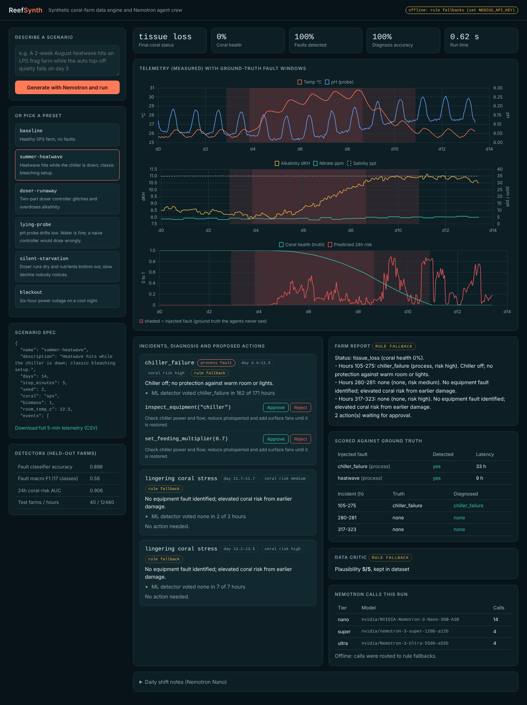
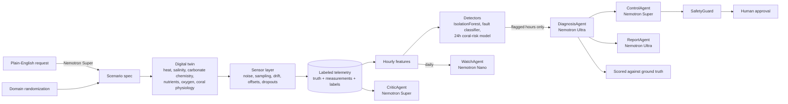

# ReefSynth

**A synthetic data engine and NVIDIA Nemotron agent crew for coral farm health, running on Nebius Token Factory.**

Commercial coral farms and reef-restoration nurseries lose stock to problems that build slowly and quietly: a heater relay that welds shut, a doser that runs dry, a pH probe that drifts, a heatwave that arrives while the chiller is down. By the time a person notices, the corals are already bleaching.

The obvious fix is an AI that watches the telemetry. The obstacle is data: **no farm can crash its own corals to produce labeled failure examples**, and real logs almost never record what actually went wrong. ReefSynth solves that by generating the failures instead:

1. A **process-based digital twin** of a coral farm synthesizes realistic, fully labeled telemetry for any scenario, including 16 kinds of equipment, environmental and sensor faults.
2. **Classical ML detectors** are trained on that synthetic data and evaluated on farms they have never seen.
3. A **crew of Nemotron agents** on Nebius Token Factory turns detector alerts into a diagnosis, separates "the water is changing" from "the probe is lying", proposes safety-checked actions that wait for human approval, and writes the operator's daily report.
4. Every run is **scored against ground truth**, because the simulator knows exactly what it injected.

Hackathon track: **Physical AI** (sensing and acting in a real-world system; this submission has no hardware, so the demo shows the key application modules in action).



---

## How NVIDIA Nemotron is used

All model calls go through **Nebius Token Factory's OpenAI-compatible API** (`https://api.tokenfactory.nebius.com/v1/`). Each agent is routed to the smallest Nemotron tier that can do its job well, so a farm can be monitored on a small credit budget.

| Agent | Nemotron tier | Model ID (default) | What it does |
|---|---|---|---|
| ScenarioAgent | Nemotron 3 **Super** | `nvidia/nemotron-3-super-120b-a12b` | Turns a plain-English request ("a two-week heatwave hits an LPS farm while the top-off fails") into a validated scenario spec for the simulator. This is LLM-guided synthetic data generation. |
| CriticAgent | Nemotron 3 **Super** | same | LLM-as-judge: reviews each synthetic farm for physical and biological plausibility before it enters the dataset. |
| WatchAgent | Nemotron 3 **Nano** | `nvidia/NVIDIA-Nemotron-3-Nano-30B-A3B` | High-volume, cheap: writes a daily shift note from that day's telemetry. |
| DiagnosisAgent | Nemotron 3 **Ultra** | `nvidia/Nemotron-3-Ultra-550b-a55b` | Deep reasoning on each incident: root cause, process vs. sensor fault (by cross-checking correlated signals), evidence with numbers, and 24-hour coral risk. |
| ControlAgent | Nemotron 3 **Super** | `nvidia/nemotron-3-super-120b-a12b` | Proposes up to 3 actions from a fixed action vocabulary. A deterministic **SafetyGuard** clamps or rejects anything outside hard limits and blocks chemistry changes when a sensor fault is suspected. Every action waits for operator approval. |
| ReportAgent | Nemotron 3 **Ultra** | `nvidia/Nemotron-3-Ultra-550b-a55b` | Writes the farm health report for the owner. |

Code: [`reefsynth/llm.py`](reefsynth/llm.py) (Token Factory client, tier routing, call ledger) and [`reefsynth/agents.py`](reefsynth/agents.py) (prompts and agents).

**Where Token Factory accelerated the workflow**

- **One API, three model sizes.** Swapping a role between Nano, Super and Ultra is a one-line change, which made it fast to find the cheapest tier that still did each job well.
- **ML first, Nemotron second.** The scikit-learn detectors score every hour for free; Token Factory is called only for flagged incidents. A 14-day farm typically costs 1-4 Ultra calls, a few Super calls and one Nano call per day.
- **OpenAI-compatible.** The standard `openai` Python client works unchanged; optional LangSmith tracing wraps the same client.
- **Model IDs are configurable** (`NEMOTRON_NANO_MODEL`, `NEMOTRON_SUPER_MODEL`, `NEMOTRON_ULTRA_MODEL`) because Token Factory's catalog changes.

**Other Nebius services**

- **Nebius Serverless Jobs** run the batch pipeline ([`jobs/generate_and_train.sh`](jobs/generate_and_train.sh)): synthesize hundreds of farms, train the detectors, then score the full agent crew on fresh farms.
- **Nebius Serverless Endpoints** host the dashboard and API from the same container.

Without `NEBIUS_API_KEY` every agent falls back to a deterministic rule-based answer, so anyone can run the repo. The dashboard shows which path produced each answer (`Nemotron` or `rule fallback`).

---

## Architecture



### The digital twin

[`reefsynth/simulator.py`](reefsynth/simulator.py) steps a coral-farm system every 5 minutes:

- **Heat balance:** room temperature with a daily swing, light and pump heat, a heater with hysteresis and a chiller.
- **Salinity:** evaporation (faster when warm and lit) and an automatic top-off.
- **Calcification:** consumes alkalinity and calcium in the real 1 dKH : 7.15 ppm ratio, and slows with light, coral health, heat stress and low alkalinity.
- **Dosing controller:** auto-tunes daily from the **measured** alkalinity, so a bad sensor can mislead it, as in a real farm.
- **Nutrients:** daily feeding and first-order export by the skimmer and coral uptake.
- **pH and oxygen:** pH tracks alkalinity, photosynthesis, temperature and room CO2; oxygen tracks temperature, light and circulation.
- **Weekly 10% water changes.**
- **Coral physiology:** degree heating hours above a species threshold, a bleaching index, tissue health and a health label (`healthy`, `stressed`, `bleaching`, `tissue_loss`) for SPS, LPS and soft corals.
- **Sensors:** per-probe noise and sampling intervals (continuous probes; alkalinity every 2 h; nitrate and phosphate every 12 h; calcium and magnesium daily), random spikes, probe drift and offsets, and telemetry dropouts.

Constants are tuned for realistic magnitudes and documented inline so they can be calibrated against real farm logs. It is a training-data engine, not a peer-reviewed reef model.

### Fault library

| Process faults (the water really changes) | Sensor faults (the probe is lying) |
|---|---|
| heater stuck on, heater failure, chiller failure, heatwave, top-off failure, top-off stuck on, doser overdose, doser empty, skimmer failure, overfeeding, nutrient starvation, power outage, room CO2 spike | pH probe drift, temperature probe offset, telemetry dropout |

---

## ML engineering techniques

- **Simulation-based synthetic data with domain randomization:** coral type, stocking density, room climate and fault combinations are randomized per farm.
- **Fault injection and correct-by-construction labels:** every row carries the true chemistry, the measured chemistry, the active fault, its kind (process or sensor) and the coral state.
- **LLM-guided scenario generation and LLM-as-judge data review** (Nemotron Super).
- **Leak-free features:** detectors see only measurements and equipment states, never ground truth.
- **Grouped evaluation:** train/test split by farm, not by row, so metrics reflect a farm the model has never seen. Demo presets are excluded from training.
- **Unsupervised anomaly detection** (IsolationForest trained only on fault-free hours).
- **Supervised fault classification** (HistGradientBoosting, class-balanced, 17 classes).
- **24-hour early-warning model** (will the corals be stressed or worse within 24 hours?).
- **Tiered LLM routing:** cheap ML on every hour, the right Nemotron tier per task.
- **Guardrailed agent actions with human-in-the-loop approval.**
- **Instruction-tuning dataset export** (`instruct.jsonl`: 24 hours of telemetry paired with the ground-truth diagnosis and action), ready for fine-tuning a Nemotron model.

This project does not use robotic process automation (RPA). The automation is agentic: models read telemetry and propose actions through a fixed, guarded action interface, not scripted UI clicks.

---

## Results

Detectors trained on 160 synthetic farms and tested on 40 unseen farms (12,480 test hours) from [`models/metrics.json`](models/metrics.json):

| Metric | Value |
|---|---|
| Fault classifier accuracy (17 classes incl. "none") | 0.896 |
| Fault classifier macro F1 | 0.56 |
| 24-hour coral-risk AUC | 0.906 |

Full pipeline on 30 fresh farms, offline rule fallbacks only ([`examples/eval-offline-30-farms.json`](examples/eval-offline-30-farms.json)):

| Metric | Value |
|---|---|
| Injected faults detected | 79% |
| Median detection latency | under 1 hour |
| Root cause correct (real faults) | 87% |
| Sensor vs. process call correct | 91% |

Run `reefsynth eval --n 30` with `NEBIUS_API_KEY` set to score the Nemotron path on the same farms.

Some faults are genuinely silent. A failed chiller does nothing in a cool room until a heatwave arrives, which is why detection latency for that fault can be days. The simulator reproduces that, and the evaluation reports it honestly.

---

## Quickstart

```bash
git clone https://github.com/divyeshparekh9496/reef-synth33.git
cd reef-synth33
python -m venv .venv && source .venv/bin/activate
pip install -r requirements.txt && pip install --no-deps -e .

export NEBIUS_API_KEY=...        # Token Factory key; omit to run offline with rule fallbacks
reefsynth serve --port 8000      # open http://localhost:8000
```

Trained detectors ship in `models/`, so the dashboard works immediately.

### CLI

```bash
reefsynth run --preset summer-heatwave                          # full pipeline on one farm
reefsynth run --prompt "doser runs dry on an SPS farm in week 2"  # Nemotron writes the scenario
reefsynth generate --out data --n 300                           # synthesize a dataset
reefsynth train --data data --out models                        # retrain detectors
reefsynth eval --n 30                                           # score the crew on unseen farms
pytest -q                                                       # tests
```

### Docker

```bash
docker build -t reef-synth .
docker run -p 8000:8000 -e NEBIUS_API_KEY=$NEBIUS_API_KEY reef-synth
```

CI publishes the image to `ghcr.io/divyeshparekh9496/reef-synth:latest` on every push to `main`. Make the package public in GitHub (Packages, then Package settings) so Nebius can pull it without a registry secret.

### Deploy on Nebius

Dashboard and API as a **Serverless Endpoint** (CPU is enough):

```bash
export AUTH_TOKEN=$(openssl rand -hex 32)
nebius ai endpoint create \
  --name reefsynth \
  --image ghcr.io/divyeshparekh9496/reef-synth:latest \
  --platform cpu-d3 --preset 4vcpu-16gb \
  --container-port 8000 \
  --env NEBIUS_API_KEY=$NEBIUS_API_KEY \
  --auth token --token "$AUTH_TOKEN"
```

Batch synthesis, training and evaluation as a **Serverless Job**:

```bash
nebius ai create --type job \
  --name reefsynth-batch \
  --image ghcr.io/divyeshparekh9496/reef-synth:latest \
  --container-command bash --args "jobs/generate_and_train.sh" \
  --env N_FARMS=400 --env EVAL_FARMS=20 --env NEBIUS_API_KEY=$NEBIUS_API_KEY \
  --platform cpu-d3 --preset 4vcpu-16gb \
  --timeout 1h
nebius ai job logs $(nebius ai job get-by-name --name reefsynth-batch --format jsonpath='{.metadata.id}')
```

Prefer `--env-secret` with a MysteryBox secret over passing the key in plain text. Check `nebius ai create --help` for the platforms and presets available in your region.

---

## Data format

`reefsynth generate` writes:

| File | Contents |
|---|---|
| `telemetry/<farm>.csv.gz` | 5-minute rows: `true_*` (ground truth), `meas_*` (what the probes reported), equipment states, `fault`, `fault_kind`, `coral_health`, `bleaching_index`, `degree_heating_hours`, stress components, `health_class` |
| `hourly.csv.gz` | hourly feature rows plus labels (`label_fault`, `label_health`, `label_risk_24h`) and `split` |
| `scenarios.jsonl` | the exact spec behind every farm, so any farm can be regenerated |
| `instruct.jsonl` | instruction-tuning pairs: telemetry window to ground-truth diagnosis and action |
| `manifest.json` | counts and class balance |

Samples are in [`examples/`](examples/).

---

## Project layout

```
reefsynth/
  profiles.py    tank and coral profiles, healthy ranges, safety limits
  scenarios.py   fault library, scenario spec, domain randomization, demo presets
  simulator.py   the digital twin and sensor layer
  features.py    leak-free hourly features and labels
  dataset.py     parallel batch generation and instruction-pair export
  ml.py          anomaly detector, fault classifier, early-warning model
  llm.py         Token Factory client, Nemotron tier routing, call ledger
  agents.py      scenario, critic, watch, diagnosis, control (+ SafetyGuard), report agents
  pipeline.py    end-to-end run and scoring against ground truth
  api.py         FastAPI app; static/index.html is the dashboard
  cli.py         command line
jobs/            Nebius Serverless Job entry point
models/          trained detectors and their held-out metrics
examples/        sample telemetry, instruction pairs, manifests, evaluation
tests/           pytest suite
```

---

## Limitations and next steps

- Calibrate the simulator constants against real farm controller logs (Neptune Apex, GHL and similar export CSV).
- Add a vision path: synthetic coral imagery (for example with NVIDIA Cosmos) paired with the simulated bleaching index, and a vision-language model for photo-based health checks.
- Connect real probes through a small edge device, so the same agents act on live tanks.
- Fine-tune a small Nemotron model on `instruct.jsonl` and compare it with prompting.

## License

[Apache License 2.0](LICENSE)
